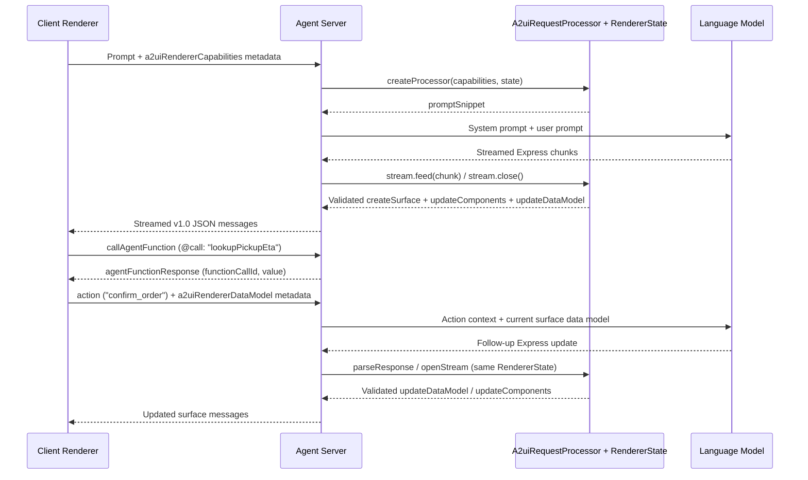

import {Aside, Tabs, TabItem} from '@astrojs/starlight/components';
import SchemaChips from '../../../components/docs/common/SchemaChips.astro';

Backend and agent developers can add A2UI UI generation to a TypeScript, Python, or Dart [agent](../../concepts/glossary/#agent) server so a language model streams validated interactive [surfaces](../../concepts/glossary/#surface) to clients and handles multi-turn user actions.

If you are building the client application instead, see [How to Integrate A2UI into a Client](../../guides/client-integration/). To share custom widgets beyond the built-in [Basic catalog](../../specification/v1.0-basic-catalog-implementation-guide/#basic_catalog.json), see [How to Define a Catalog](../../guides/defining-a-catalog/), and for wire vs. compact DSL trade-offs see [Swappable Inference Formats](../../concepts/inference-formats/). Swift (`A2UISwiftCore` and `A2UISwiftUI`) targets client-side rendering rather than server-side agent generation.

---

## Step 1: Install dependencies

Install the Agent SDK and Core SDK packages for your server language:

<Tabs syncKey="sdk-lang">
  <TabItem label="TypeScript">

```bash
npm install @a2ui/agent @a2ui/web_core
```

  </TabItem>
  <TabItem label="Python">

```bash
pip install a2ui-agent-sdk

# Optional integrations for Google ADK and A2A servers:
pip install a2ui-adk "a2ui-adk[a2a]" a2ui-a2a
```

  </TabItem>
  <TabItem label="Dart">

```bash
dart pub add a2ui_agent a2ui_core
```

  </TabItem>
</Tabs>

---

## Step 2: Configure A2uiGenerator, catalogs, and inference format

Create one [`A2uiGenerator`](../../concepts/glossary/#a2uigenerator) when your server starts and share it across requests. Register every [catalog](../../concepts/catalogs/#using-a-catalog-in-an-agent) the agent supports inside a `CatalogConfig` wrapper, starting with the built-in `v1.0` Basic catalog and adding any domain-specific `catalog.json` files via `CatalogConfig.fromPath` (in TypeScript and Dart) or `CatalogConfig.from_path` (in Python).

By default, `A2uiGenerator` configures `ExpressFormatFactory`, which instructs the model to emit the compact `<a2ui>` [inference format](../../concepts/glossary/#inference-format) and compiles each statement into A2UI JSON messages. If your model or fine-tuned checkpoint writes raw A2UI JSON envelopes inside `<a2ui-json>` tags instead, pass `DirectJsonFormatFactory` (`new DirectJsonFormatFactory()` in TypeScript, `DirectJsonFormatFactory()` in Python, or `const DirectJsonFormatFactory()` in Dart).

<Tabs syncKey="sdk-lang">
  <TabItem label="TypeScript">

```typescript
// src/order-agent.ts
import {
  A2uiError,
  A2uiGenerator,
  type A2uiRequestProcessor,
  type AgentToRendererMessage,
  CatalogConfig,
  ExpressFormatFactory,
  type RendererCapabilities,
  type RendererState,
} from '@a2ui/agent';
import {basicCatalog} from '@a2ui/web_core/v1_0';

export class OrderAgentService {
  readonly generator: A2uiGenerator;
  private readonly sessions = new Map<string, RendererState>();

  constructor() {
    const formatFactory = new ExpressFormatFactory({
      surfaceId: 'order_summary', // Optional (default: 'main')
      allowedMessages: ['createSurface', 'updateComponents', 'updateDataModel'], // Optional (default: undefined)
      progressiveKeys: ['text'], // Optional (default: ['text'])
    });

    this.generator = new A2uiGenerator(
      [
        new CatalogConfig(basicCatalog),
        // Optional custom catalog: CatalogConfig.fromPath('./catalog.json'),
      ],
      undefined, // Optional examples (default: undefined)
      formatFactory, // Optional (default: new ExpressFormatFactory())
    );
  }
}
```

  </TabItem>
  <TabItem label="Python">

```python
# order_agent.py
from __future__ import annotations

import json
from collections.abc import AsyncIterable, Awaitable, Callable
from typing import Any

from a2ui.core import A2uiError
from a2ui.core.basic_catalog import BasicCatalog
from a2ui.core.schema import ProtocolVersion
from a2ui.inference_formats import to_message_dicts
from a2ui.inference_formats.express import ExpressFormatFactory
from a2ui.parser import A2uiPart
from a2ui.processor import A2uiGenerator, A2uiRequestProcessor, CatalogConfig
from a2ui.utils import RendererState


class OrderAgentService:
  def __init__(self) -> None:
    basic = BasicCatalog(ProtocolVersion.V1_0)
    self.basic_catalog_id = basic.catalog_id

    format_factory = ExpressFormatFactory(
        allowed_messages=["createSurface", "updateComponents", "updateDataModel"],  # Optional (default: None)
        surface_id="order_summary",  # Optional (default: "main")
        progressive_keys={"text"},  # Optional (default: {"text"})
    )

    self.generator = A2uiGenerator(
        catalogs=[
            CatalogConfig(catalog=basic),
            # Optional custom catalog: CatalogConfig.from_path("./catalog.json"),
        ],
        examples=None,  # Optional (default: None)
        inference_format_factory=format_factory,  # Optional (default: ExpressFormatFactory())
        accepts_inline_catalogs=False,  # Optional (default: False)
    )
    self.sessions: dict[str, RendererState] = {}
```

  </TabItem>
  <TabItem label="Dart">

```dart
// lib/order_agent.dart
import 'dart:convert';

import 'package:a2ui_agent/a2ui_agent.dart';
import 'package:a2ui_core/a2ui_core.dart';

class OrderAgentService {
  late final A2uiGenerator generator;
  final Map<String, RendererState> _sessions = {};

  OrderAgentService() {
    const formatFactory = ExpressFormatFactory(
      allowedMessages: [
        'createSurface',
        'updateComponents',
        'updateDataModel',
      ], // Optional (default: null)
      progressiveKeys: {'text'}, // Optional (default: {'text'})
    );

    generator = A2uiGenerator(
      catalogs: [
        CatalogConfig(BasicCatalog.v1_0()),
        // Optional custom catalog: CatalogConfig.fromPath('./catalog.json'),
      ],
      examples: const [], // Optional (default: const [])
      inferenceFormatFactory:
          formatFactory, // Optional (default: ExpressFormatFactory())
    );
  }
}
```

  </TabItem>
</Tabs>

In Python, you can also compose reusable server-side component templates with `@macro` and expand them into Basic catalog primitives through [`MacroExpander`](../../concepts/glossary/#macroexpander) (`from a2ui.transformers.macros import MacroExpander, macro`) so mobile and web clients render new composite layouts without a client release.

---

## Step 3: Negotiate capabilities and build the system prompt

On every client request, read `metadata.a2uiRendererCapabilities` (or `metadata.a2uiClientCapabilities` for `v0.9.1` clients) and negotiate an `A2uiRequestProcessor` for that caller's supported [catalogs](../../concepts/catalogs/#catalog-negotiation-and-multi-catalog-surfaces).

How you manage `RendererState` depends on your UI lifecycle:

1. Multi-turn canvas sessions keep one `RendererState` per conversation so later turns can update or delete surfaces created in earlier turns. Check `acceptsState` (`accepts_state` in Python) on each turn in case the client's negotiated catalogs changed, and bind `state` to the request processor.
2. Stateless chat turns omit `state`, validating each model response against a fresh `RendererState` so every turn creates its own self-contained surface.

Append `processor.promptSnippet` (`processor.prompt_snippet` in Python) to your agent's role instructions before calling the language model:

<Tabs syncKey="sdk-lang">
  <TabItem label="TypeScript">

```typescript
// Inside OrderAgentService (src/order-agent.ts):
prepareTurn(
  sessionId: string,
  capabilitiesPayload?: Record<string, RendererCapabilities>,
): {processor: A2uiRequestProcessor; state: RendererState; systemPrompt: string} {
  const capabilities: Record<string, RendererCapabilities> = capabilitiesPayload ?? {
    '1.0': {supportedCatalogIds: [basicCatalog.id]},
  };

  const probe = this.generator.createProcessor(capabilities);
  let state = this.sessions.get(sessionId);
  if (!state || !probe.acceptsState(state)) {
    state = probe.createState();
    this.sessions.set(sessionId, state);
  }

  const processor = this.generator.createProcessor(capabilities, undefined, {state});
  const systemPrompt = [
    'You are an order assistant. Show order details in an interactive card.',
    processor.promptSnippet,
  ].join('\n\n');

  return {processor, state, systemPrompt};
}
```

  </TabItem>
  <TabItem label="Python">

```python
# Inside OrderAgentService (order_agent.py):
def prepare_turn(
    self,
    session_id: str,
    capabilities_payload: dict[str, Any] | None = None,
) -> tuple[A2uiRequestProcessor, RendererState, str]:
  capabilities = capabilities_payload or {
      "1.0": {"supportedCatalogIds": [self.basic_catalog_id]}
  }

  probe = self.generator.create_processor(capabilities)
  state = self.sessions.get(session_id)
  if state is None or not probe.accepts_state(state):
    state = probe.create_state()
    self.sessions[session_id] = state

  processor = self.generator.create_processor(capabilities, state=state)
  system_prompt = (
      "You are an order assistant. Show order details in an interactive card.\n\n"
      f"{processor.prompt_snippet}"
  )
  return processor, state, system_prompt
```

  </TabItem>
  <TabItem label="Dart">

```dart
// Inside OrderAgentService (lib/order_agent.dart):
({
  A2uiRequestProcessor processor,
  RendererState state,
  String systemPrompt,
}) prepareTurn(
  String sessionId, {
  Map<String, Object?>? capabilitiesPayload,
}) {
  final capabilities = capabilitiesPayload != null
      ? A2uiRendererCapabilities.fromJson(capabilitiesPayload)
      : A2uiRendererCapabilities.forCatalogIds(
          [BasicCatalog.v1_0Id],
          version: A2uiProtocolVersion.v1_0,
        );

  final probe = generator.createProcessor(capabilities);
  RendererState? state = _sessions[sessionId];
  if (state == null || !probe.acceptsState(state)) {
    state = probe.createState();
    _sessions[sessionId] = state;
  }

  final processor = generator.createProcessor(capabilities, state: state);
  final systemPrompt =
      'You are an order assistant. Show order details in an interactive card.\n\n'
      '${processor.promptSnippet}';

  return (processor: processor, state: state, systemPrompt: systemPrompt);
}
```

  </TabItem>
</Tabs>

<details>
<summary>Wire format: inbound renderer capabilities metadata</summary>

Client renderers attach their supported [capabilities](../../concepts/glossary/#capabilities) in transport [metadata](../../concepts/messages/#metadata) (`a2uiRendererCapabilities` under `"1.0"` in `v1.0`, or `a2uiClientCapabilities` under `"v0.9"` in `v0.9.1`):

<SchemaChips
  items={[
    {
      version: 'v1.0',
      label: 'renderer_capabilities.json',
      href: '/specification/v1.0/schemas/#renderer_capabilities.json',
      title: 'v1.0 Renderer Capabilities Schema',
    },
    {
      version: 'v0.9.1',
      label: 'client_capabilities.json',
      href: '/specification/v0.9.1/schemas/#client_capabilities.json',
      title: 'v0.9.1 Client Capabilities Schema',
    },
  ]}
/>

<Tabs syncKey="protocol-version">
  <TabItem label="v1.0">

```json
{
  "metadata": {
    "a2uiRendererCapabilities": {
      "1.0": {
        "supportedCatalogIds": ["https://a2ui.org/specification/v1_0/catalogs/basic/catalog.json"]
      }
    }
  }
}
```

  </TabItem>
  <TabItem label="v0.9.1">

```json
{
  "metadata": {
    "a2uiClientCapabilities": {
      "v0.9": {
        "supportedCatalogIds": ["https://a2ui.org/specification/v0_9/catalogs/basic/catalog.json"]
      }
    }
  }
}
```

  </TabItem>
</Tabs>

</details>

---

## Step 4: Parse output, validate, and self-correct

`A2uiRequestProcessor` gives you two ways to turn model output into validated A2UI messages:

1. Incremental streaming (`openStream` in TypeScript and Dart, `open_stream` in Python) feeds LLM token chunks into a stateful stream reader, heals progressive string keys such as `text` while tokens arrive, applies each emitted message to `RendererState`, and yields [`createSurface`](../../concepts/messages/#createsurface), [`updateComponents`](../../concepts/messages/#updatecomponents), [`updateDataModel`](../../concepts/messages/#updatedatamodel), and [`deleteSurface`](../../concepts/messages/#deletesurface) messages as soon as they are ready.
2. Whole-response validation with self-correction (`parseResponse` in TypeScript and Dart, `parse_response` in Python) checks a complete response inside an atomic `RendererState` transaction. If the model invents an unknown component, omits `root`, or writes a dangling child ID, `RendererState` rolls back every change from that turn and raises `A2uiError`, whose message you can feed back to the model for a retry.

<Tabs syncKey="sdk-lang">
  <TabItem label="TypeScript">

```typescript
// Inside OrderAgentService (src/order-agent.ts):
async *streamTurn(
  processor: A2uiRequestProcessor,
  tokenChunks: AsyncIterable<string>,
): AsyncGenerator<AgentToRendererMessage> {
  const stream = processor.openStream({
    wrapped: true, // Optional (default: true)
    afterRejectedBlock: 'end', // Optional (default: 'end')
  });

  for await (const chunk of tokenChunks) {
    for (const part of stream.feed(chunk)) {
      if (part.type === 'a2ui') {
        for (const message of part.a2ui) {
          yield message;
        }
      }
    }
  }

  for (const part of stream.close()) {
    if (part.type === 'a2ui') {
      for (const message of part.a2ui) {
        yield message;
      }
    }
  }
}

async generateValidatedTurn(
  processor: A2uiRequestProcessor,
  userPrompt: string,
  callLlm: (prompt: string) => Promise<string>,
  maxRetries = 2,
): Promise<AgentToRendererMessage[]> {
  let prompt = userPrompt;
  for (let attempt = 0; attempt <= maxRetries; attempt++) {
    const rawText = await callLlm(prompt);
    try {
      const parts = processor.parseResponse(rawText, {wrapped: true});
      const messages: AgentToRendererMessage[] = [];
      for (const part of parts) {
        if (part.type === 'a2ui') {
          messages.push(...part.a2ui);
        }
      }
      return messages;
    } catch (err) {
      if (!(err instanceof A2uiError) || attempt === maxRetries) {
        throw err;
      }
      prompt = [
        userPrompt,
        `Your previous A2UI block failed validation: ${err.message}`,
        'Fix the A2UI output so every component and ID matches the catalog.',
      ].join('\n\n');
    }
  }
  return [];
}
```

  </TabItem>
  <TabItem label="Python">

```python
# Inside OrderAgentService (order_agent.py):
async def stream_turn(
    self,
    processor: A2uiRequestProcessor,
    token_chunks: AsyncIterable[str],
) -> AsyncIterable[dict[str, Any]]:
  stream = processor.open_stream(
      wrapped=True,  # Optional (default: True)
      after_rejected_block="end",  # Optional (default: "end")
  )
  async for chunk in token_chunks:
    for part in stream.feed(chunk):
      if isinstance(part, A2uiPart):
        for message in to_message_dicts(part.a2ui):
          yield message
  for part in stream.close():
    if isinstance(part, A2uiPart):
      for message in to_message_dicts(part.a2ui):
        yield message


async def generate_validated_turn(
    self,
    processor: A2uiRequestProcessor,
    user_prompt: str,
    call_llm: Callable[[str], Awaitable[str]],
    max_retries: int = 2,
) -> list[dict[str, Any]]:
  prompt = user_prompt
  for attempt in range(max_retries + 1):
    raw_text = await call_llm(prompt)
    try:
      parts = processor.parse_response(raw_text, wrapped=True)
      return [
          msg
          for part in parts
          if isinstance(part, A2uiPart)
          for msg in to_message_dicts(part.a2ui)
      ]
    except A2uiError as err:
      if attempt == max_retries:
        raise
      prompt = (
          f"{user_prompt}\n\n"
          f"Your previous A2UI block failed validation: {err}\n"
          "Fix the A2UI output so every component and ID matches the catalog."
      )
  return []
```

  </TabItem>
  <TabItem label="Dart">

```dart
// Inside OrderAgentService (lib/order_agent.dart):
Stream<Map<String, Object?>> streamTurn(
  A2uiRequestProcessor processor,
  Stream<String> tokenChunks,
) async* {
  final stream = processor.openStream(
    wrapped: true, // Optional (default: true)
  );

  await for (final chunk in tokenChunks) {
    for (final part in stream.feed(chunk)) {
      if (part is A2uiPart) {
        for (final message in part.a2ui) {
          yield message.toJson();
        }
      }
    }
  }

  for (final part in stream.close()) {
    if (part is A2uiPart) {
      for (final message in part.a2ui) {
        yield message.toJson();
      }
    }
  }
}

Future<List<Map<String, Object?>>> generateValidatedTurn(
  A2uiRequestProcessor processor,
  String userPrompt,
  Future<String> Function(String prompt) callLlm, {
  int maxRetries = 2,
}) async {
  var prompt = userPrompt;
  for (var attempt = 0; attempt <= maxRetries; attempt++) {
    final rawText = await callLlm(prompt);
    try {
      final parts = processor.parseResponse(rawText, wrapped: true);
      return [
        for (final part in parts)
          if (part is A2uiPart)
            for (final message in part.a2ui) message.toJson(),
      ];
    } on A2uiError catch (err) {
      if (attempt == maxRetries) rethrow;
      prompt = '$userPrompt\n\n'
          'Your previous A2UI block failed validation: $err\n'
          'Fix the A2UI output so every component and ID matches the catalog.';
    }
  }
  return const [];
}
```

  </TabItem>
</Tabs>

If your app runs both the agent and a local `MessageProcessor` inside the same TypeScript or Dart process, use `StreamedAnswer` (`new StreamedAnswer(processor, {renderer})` in TypeScript or `StreamedAnswer(processor, renderer: renderer)` in Dart), which binds `RendererState.of(renderer)` directly so streamed surfaces mount without JSON serialization.

<details>
<summary>Wire format: Express output and compiled messages</summary>

With `ExpressFormatFactory`, the model writes a compact `<a2ui>` block using UAX #31 component identifiers (`confirm_btn`, `confirm_label`) and `$/...` data-model bindings:

```text
<a2ui>
surface("order_summary", sendDataModel=true)
$/orderId = "ORD-4821"
$/summaryText = "2 items ready for pickup"
root = Card(col)
col = Column([headline, confirm_btn])
headline = Text($/summaryText)
confirm_btn = Button(confirm_label, _, Event("confirm_order", {orderId: $/orderId}))
confirm_label = Text("Confirm order")
</a2ui>
```

The parser compiles that block into validated JSON messages (`"version": "1.0"` with `{"@path": "..."}` bindings in `v1.0`, or `"version": "v0.9"` with `{"path": "..."}` bindings in `v0.9.1`). During incremental `openStream` / `open_stream` reads, `v1.0` emits `createSurface` with the initial `root` and `dataModel` followed by `updateComponents` deltas as remaining components arrive; when parsed whole via `parseResponse` / `parse_response`, `v1.0` folds all initial components and data into `createSurface`:

<SchemaChips
  items={[
    {
      version: 'v1.0',
      label: 'agent_to_renderer.json',
      href: '/specification/v1.0/schemas/#agent_to_renderer.json',
      title: 'v1.0 Agent-to-Renderer Message Schema',
    },
    {
      version: 'v0.9.1',
      label: 'server_to_client.json',
      href: '/specification/v0.9.1/schemas/#server_to_client.json',
      title: 'v0.9.1 Server-to-Client Message Schema',
    },
  ]}
/>

<Tabs syncKey="protocol-version">
  <TabItem label="v1.0">

```json
[
  {
    "version": "1.0",
    "createSurface": {
      "surfaceId": "order_summary",
      "catalogId": "https://a2ui.org/specification/v1_0/catalogs/basic/catalog.json",
      "sendDataModel": true,
      "components": [
        {"id": "root", "component": "Card", "child": "col"},
        {"id": "col", "component": "Column", "children": ["headline", "confirm_btn"]},
        {"id": "headline", "component": "Text", "text": {"@path": "/summaryText"}},
        {
          "id": "confirm_btn",
          "component": "Button",
          "child": "confirm_label",
          "action": {
            "event": {"name": "confirm_order", "context": {"orderId": {"@path": "/orderId"}}}
          }
        },
        {"id": "confirm_label", "component": "Text", "text": "Confirm order"}
      ],
      "dataModel": {
        "orderId": "ORD-4821",
        "summaryText": "2 items ready for pickup"
      }
    }
  }
]
```

  </TabItem>
  <TabItem label="v0.9.1">

```json
[
  {
    "version": "v0.9",
    "createSurface": {
      "surfaceId": "order_summary",
      "catalogId": "https://a2ui.org/specification/v0_9/catalogs/basic/catalog.json",
      "sendDataModel": true
    }
  },
  {
    "version": "v0.9",
    "updateComponents": {
      "surfaceId": "order_summary",
      "components": [
        {"id": "root", "component": "Card", "child": "col"},
        {"id": "col", "component": "Column", "children": ["headline", "confirm_btn"]},
        {"id": "headline", "component": "Text", "text": {"path": "/summaryText"}},
        {
          "id": "confirm_btn",
          "component": "Button",
          "child": "confirm_label",
          "action": {
            "event": {"name": "confirm_order", "context": {"orderId": {"path": "/orderId"}}}
          }
        },
        {"id": "confirm_label", "component": "Text", "text": "Confirm order"}
      ]
    }
  },
  {
    "version": "v0.9",
    "updateDataModel": {
      "surfaceId": "order_summary",
      "path": "/",
      "value": {"orderId": "ORD-4821", "summaryText": "2 items ready for pickup"}
    }
  }
]
```

  </TabItem>
</Tabs>

</details>

---

## Step 5: Handle inbound actions, data models, and function RPCs

Clients send three main [`renderer_to_agent`](../../specification/v1.0/schemas/#renderer_to_agent.json) messages back to your server (plus `rendererFunctionResponse` if your agent invokes [`callRendererFunction`](../../concepts/messages/#callrendererfunction-v10-only)):

1. [`callAgentFunction`](../../concepts/messages/#callagentfunction-v10-only) (`v1.0` only) invokes a backend catalog function via `callFunction["@call"]` and `callFunction["args"]`. Execute your backend logic directly and return [`agentFunctionResponse`](../../concepts/messages/#agentfunctionresponse-v10-only) correlated by `functionCallId` (`value` on success, or `error` on failure) without an LLM round-trip.
2. [`action`](../../concepts/messages/#action) reports a user UI event (`name`, `surfaceId`, `sourceComponentId`, `context`). When the surface was created with [`sendDataModel: true`](../../concepts/data-binding/#senddatamodel-true), read the synchronized surface [data model](../../concepts/glossary/#data-model) from `metadata.a2uiRendererDataModel.surfaces[surfaceId]` (`metadata.a2uiClientDataModel.surfaces[surfaceId]` in `v0.9.1`) and include both in the next LLM turn so the model can update `"order_summary"` in place.
3. [`error`](../../specification/v1.0/schemas/#renderer_to_agent.json/properties/error) reports a client-side `VALIDATION_FAILED` or function error (`code`, `surfaceId`, `message`), which you can forward into a repair turn.

<Tabs syncKey="sdk-lang">
  <TabItem label="TypeScript">

```typescript
// Inside OrderAgentService (src/order-agent.ts):
export interface ClientRequestMetadata {
  a2uiRendererCapabilities?: Record<string, RendererCapabilities>;
  a2uiRendererDataModel?: {
    version: string;
    surfaces?: Record<string, Record<string, unknown>>;
  };
}

// Add inside class OrderAgentService:
async handleClientEnvelope(
  envelope: Record<string, unknown>,
  metadata?: ClientRequestMetadata,
): Promise<
  | {kind: 'rpc'; reply: Record<string, unknown>}
  | {kind: 'prompt'; prompt: string}
> {
  if (
    'callAgentFunction' in envelope &&
    typeof envelope.callAgentFunction === 'object' &&
    envelope.callAgentFunction !== null
  ) {
    const rpc = envelope.callAgentFunction as {
      functionCallId: string;
      callFunction: {'@call': string; args?: Record<string, unknown>};
    };
    const fnName = rpc.callFunction['@call'];
    const args = rpc.callFunction.args ?? {};
    if (fnName === 'lookupPickupEta') {
      return {
        kind: 'rpc',
        reply: {
          version: '1.0',
          agentFunctionResponse: {
            functionCallId: rpc.functionCallId,
            value: {
              orderId: String(args.orderId ?? 'unknown'),
              eta: 'Today, 5:30 PM',
            },
          },
        },
      };
    }
    return {
      kind: 'rpc',
      reply: {
        version: '1.0',
        agentFunctionResponse: {
          functionCallId: rpc.functionCallId,
          error: {
            code: 'EXECUTION_ERROR',
            message: `Unsupported agent function: ${fnName}`,
          },
        },
      },
    };
  }

  if (
    'action' in envelope &&
    typeof envelope.action === 'object' &&
    envelope.action !== null
  ) {
    const act = envelope.action as {
      name: string;
      surfaceId: string;
      context: Record<string, unknown>;
    };
    const surfaceData =
      metadata?.a2uiRendererDataModel?.surfaces?.[act.surfaceId] ?? {};
    return {
      kind: 'prompt',
      prompt:
        `User triggered action '${act.name}' on surface '${act.surfaceId}' ` +
        `with context ${JSON.stringify(act.context)} and data model ` +
        `${JSON.stringify(surfaceData)}.`,
    };
  }

  if (
    'error' in envelope &&
    typeof envelope.error === 'object' &&
    envelope.error !== null
  ) {
    const err = envelope.error as {
      code: string;
      surfaceId: string;
      message: string;
    };
    return {
      kind: 'prompt',
      prompt: `Renderer reported ${err.code} on surface '${err.surfaceId}': ${err.message}.`,
    };
  }

  throw new Error('Unsupported renderer_to_agent message');
}
```

  </TabItem>
  <TabItem label="Python">

```python
# Inside OrderAgentService (order_agent.py):
async def handle_client_envelope(
    self,
    envelope: dict[str, Any],
    metadata: dict[str, Any] | None = None,
) -> dict[str, Any] | str:
  if "callAgentFunction" in envelope:
    rpc = envelope["callAgentFunction"]
    call = rpc["callFunction"]
    fn_name = call["@call"]
    args = call.get("args", {})
    if fn_name == "lookupPickupEta":
      return {
          "version": "1.0",
          "agentFunctionResponse": {
              "functionCallId": rpc["functionCallId"],
              "value": {
                  "orderId": args.get("orderId", "unknown"),
                  "eta": "Today, 5:30 PM",
              },
          },
      }
    return {
        "version": "1.0",
        "agentFunctionResponse": {
            "functionCallId": rpc["functionCallId"],
            "error": {
                "code": "EXECUTION_ERROR",
                "message": f"Unsupported agent function: {fn_name}",
            },
        },
    }

  if "action" in envelope:
    act = envelope["action"]
    surface_id = act["surfaceId"]
    surface_data = (
        (metadata or {})
        .get("a2uiRendererDataModel", {})
        .get("surfaces", {})
        .get(surface_id, {})
    )
    return (
        f"User triggered action '{act['name']}' on surface '{surface_id}' "
        f"with context {json.dumps(act['context'])} and data model "
        f"{json.dumps(surface_data)}."
    )

  if "error" in envelope:
    err = envelope["error"]
    return (
        f"Renderer reported {err['code']} on surface '{err['surfaceId']}': "
        f"{err['message']}."
    )

  raise ValueError("Unsupported renderer_to_agent message")
```

  </TabItem>
  <TabItem label="Dart">

```dart
// Inside OrderAgentService (lib/order_agent.dart):
Future<Object> handleClientEnvelope(
  Map<String, Object?> envelope, {
  Map<String, Object?>? metadata,
}) async {
  final rpc = envelope['callAgentFunction'];
  if (rpc is Map<String, Object?>) {
    final call = (rpc['callFunction'] as Map).cast<String, Object?>();
    final fnName = call['@call'] as String;
    final args =
        (call['args'] as Map?)?.cast<String, Object?>() ?? const {};
    if (fnName == 'lookupPickupEta') {
      return <String, Object?>{
        'version': '1.0',
        'agentFunctionResponse': {
          'functionCallId': rpc['functionCallId'],
          'value': {
            'orderId': args['orderId'] ?? 'unknown',
            'eta': 'Today, 5:30 PM',
          },
        },
      };
    }
    return <String, Object?>{
      'version': '1.0',
      'agentFunctionResponse': {
        'functionCallId': rpc['functionCallId'],
        'error': {
          'code': 'EXECUTION_ERROR',
          'message': 'Unsupported agent function: $fnName',
        },
      },
    };
  }

  final act = envelope['action'];
  if (act is Map<String, Object?>) {
    final surfaceId = act['surfaceId'] as String;
    final dataModelMeta =
        (metadata?['a2uiRendererDataModel'] as Map?)?.cast<String, Object?>();
    final surfaces =
        (dataModelMeta?['surfaces'] as Map?)?.cast<String, Object?>();
    final surfaceData = surfaces?[surfaceId] ?? const <String, Object?>{};
    return "User triggered action '${act['name']}' on surface '$surfaceId' "
        'with context ${jsonEncode(act['context'])} and data model '
        '${jsonEncode(surfaceData)}.';
  }

  final err = envelope['error'];
  if (err is Map<String, Object?>) {
    return 'Renderer reported ${err['code']} on surface '
        "'${err['surfaceId']}': ${err['message']}.";
  }

  throw ArgumentError('Unsupported renderer_to_agent message');
}
```

  </TabItem>
</Tabs>

<details>
<summary>Wire format: inbound action, callAgentFunction, and agentFunctionResponse</summary>

Below are the wire envelopes for an inbound [`action`](../../concepts/messages/#action) with synchronized data-model metadata in `v1.0` and `v0.9.1`, plus the `v1.0` [`callAgentFunction`](../../concepts/messages/#callagentfunction-v10-only) request and [`agentFunctionResponse`](../../concepts/messages/#agentfunctionresponse-v10-only) reply:

<SchemaChips
  items={[
    {
      version: 'v1.0',
      label: 'renderer_to_agent.json',
      href: '/specification/v1.0/schemas/#renderer_to_agent.json',
      title: 'v1.0 Renderer-to-Agent Message Schema',
    },
    {
      version: 'v1.0',
      label: 'renderer_data_model.json',
      href: '/specification/v1.0/schemas/#renderer_data_model.json',
      title: 'v1.0 Renderer Data Model Metadata Schema',
    },
    {
      version: 'v1.0',
      label: 'AgentFunctionResponseMessage',
      href: '/specification/v1.0/schemas/#agent_to_renderer.json/$defs/AgentFunctionResponseMessage',
      title: 'v1.0 Agent Function Response Schema',
    },
    {
      version: 'v0.9.1',
      label: 'client_to_server.json',
      href: '/specification/v0.9.1/schemas/#client_to_server.json',
      title: 'v0.9.1 Client-to-Server Message Schema',
    },
    {
      version: 'v0.9.1',
      label: 'client_data_model.json',
      href: '/specification/v0.9.1/schemas/#client_data_model.json',
      title: 'v0.9.1 Client Data Model Metadata Schema',
    },
  ]}
/>

<Tabs syncKey="protocol-version">
  <TabItem label="v1.0">

Inbound `action` request with `a2uiRendererDataModel` transport metadata:

```json
{
  "message": {
    "version": "1.0",
    "action": {
      "name": "confirm_order",
      "surfaceId": "order_summary",
      "sourceComponentId": "confirm_btn",
      "timestamp": "2026-05-01T18:30:00.000Z",
      "context": {
        "orderId": "ORD-4821"
      }
    }
  },
  "metadata": {
    "a2uiRendererDataModel": {
      "version": "1.0",
      "surfaces": {
        "order_summary": {
          "orderId": "ORD-4821",
          "summaryText": "2 items ready for pickup"
        }
      }
    }
  }
}
```

Inbound `callAgentFunction` wire message and outbound `agentFunctionResponse` reply:

```json
{
  "version": "1.0",
  "callAgentFunction": {
    "surfaceId": "order_summary",
    "functionCallId": "call_01",
    "callFunction": {
      "@call": "lookupPickupEta",
      "catalogId": "https://example.com/catalogs/orders/v1/catalog.json",
      "args": {
        "orderId": "ORD-4821"
      }
    }
  }
}
```

```json
{
  "version": "1.0",
  "agentFunctionResponse": {
    "functionCallId": "call_01",
    "value": {
      "orderId": "ORD-4821",
      "eta": "Today, 5:30 PM"
    }
  }
}
```

  </TabItem>
  <TabItem label="v0.9.1">

```json
{
  "message": {
    "version": "v0.9",
    "action": {
      "name": "confirm_order",
      "surfaceId": "order_summary",
      "sourceComponentId": "confirm_btn",
      "timestamp": "2026-05-01T18:30:00.000Z",
      "context": {
        "orderId": "ORD-4821"
      }
    }
  },
  "metadata": {
    "a2uiClientDataModel": {
      "version": "v0.9",
      "surfaces": {
        "order_summary": {
          "orderId": "ORD-4821",
          "summaryText": "2 items ready for pickup"
        }
      }
    }
  }
}
```

  </TabItem>
</Tabs>

</details>

---

## Step 6: Wire everything at the server entry point

Connect `OrderAgentService` from Steps 2 through 5 to an HTTP endpoint (`POST /api/agent`) that accepts initial prompts and client envelopes (`{sessionId, prompt, message, metadata}`), replies immediately to `callAgentFunction` RPCs with JSON, and streams validated A2UI messages over Server-Sent Events (`text/event-stream`):

<Tabs syncKey="sdk-lang">
  <TabItem label="TypeScript">

```typescript
// src/server.ts
import {createServer, type IncomingMessage, type ServerResponse} from 'node:http';
import {type ClientRequestMetadata, OrderAgentService} from './order-agent.js';

interface AgentRequestBody {
  sessionId?: string;
  prompt?: string;
  message?: Record<string, unknown>;
  metadata?: ClientRequestMetadata;
}

const agentService = new OrderAgentService();

async function readJson(req: IncomingMessage): Promise<AgentRequestBody> {
  const chunks: Buffer[] = [];
  for await (const chunk of req) {
    chunks.push(Buffer.isBuffer(chunk) ? chunk : Buffer.from(chunk));
  }
  return JSON.parse(Buffer.concat(chunks).toString('utf8')) as AgentRequestBody;
}

async function* callModelStream(systemPrompt: string, userPrompt: string): AsyncGenerator<string> {
  // Replace with your LLM SDK streaming call (e.g., Gemini, OpenAI, Anthropic).
  void systemPrompt;
  if (userPrompt.startsWith('User triggered action')) {
    yield '<a2ui>\nsurface("order_summary", update=true)\n';
    yield '$/summaryText = "Order ORD-4821 confirmed for pickup"\n</a2ui>';
    return;
  }
  yield '<a2ui>\nsurface("order_summary", sendDataModel=true)\n';
  yield '$/orderId = "ORD-4821"\n$/summaryText = "2 items ready for pickup"\n';
  yield 'root = Card(col)\ncol = Column([headline, confirm_btn])\n';
  yield 'headline = Text($/summaryText)\n';
  yield 'confirm_btn = Button(confirm_label, _, Event("confirm_order", {orderId: $/orderId}))\n';
  yield 'confirm_label = Text("Confirm order")\n</a2ui>';
}

createServer(async (req: IncomingMessage, res: ServerResponse) => {
  if (req.method !== 'POST' || req.url !== '/api/agent') {
    res.writeHead(404).end();
    return;
  }

  const body = await readJson(req);
  const sessionId = body.sessionId ?? 'default';
  let turnPrompt = body.prompt ?? 'Show my order summary';

  if (body.message) {
    const outcome = await agentService.handleClientEnvelope(body.message, body.metadata);
    if (outcome.kind === 'rpc') {
      res.writeHead(200, {'Content-Type': 'application/json'});
      res.end(JSON.stringify([outcome.reply]));
      return;
    }
    turnPrompt = outcome.prompt;
  }

  const {processor, systemPrompt} = agentService.prepareTurn(
    sessionId,
    body.metadata?.a2uiRendererCapabilities,
  );

  res.writeHead(200, {
    'Content-Type': 'text/event-stream',
    'Cache-Control': 'no-cache',
    Connection: 'keep-alive',
  });

  const tokens = callModelStream(systemPrompt, turnPrompt);
  for await (const msg of agentService.streamTurn(processor, tokens)) {
    res.write(`data: ${JSON.stringify(msg)}\n\n`);
  }
  res.end();
}).listen(8080);
```

  </TabItem>
  <TabItem label="Python">

```python
# server.py
from __future__ import annotations

from collections.abc import AsyncIterable
import json
from fastapi import FastAPI, Request
from fastapi.responses import JSONResponse, StreamingResponse

from order_agent import OrderAgentService

app = FastAPI()
agent_service = OrderAgentService()


async def call_model_stream(
    system_prompt: str, user_prompt: str
) -> AsyncIterable[str]:
  # Replace with your LLM SDK streaming call (e.g., google-genai, openai, anthropic).
  del system_prompt
  if user_prompt.startswith("User triggered action"):
    yield '<a2ui>\nsurface("order_summary", update=true)\n'
    yield '$/summaryText = "Order ORD-4821 confirmed for pickup"\n</a2ui>'
    return
  yield '<a2ui>\nsurface("order_summary", sendDataModel=true)\n'
  yield '$/orderId = "ORD-4821"\n$/summaryText = "2 items ready for pickup"\n'
  yield "root = Card(col)\ncol = Column([headline, confirm_btn])\n"
  yield "headline = Text($/summaryText)\n"
  yield 'confirm_btn = Button(confirm_label, _, Event("confirm_order", {orderId: $/orderId}))\n'
  yield 'confirm_label = Text("Confirm order")\n</a2ui>'


@app.post("/api/agent")
async def handle_agent(request: Request):
  body = await request.json()
  session_id = body.get("sessionId", "default")
  metadata = body.get("metadata")
  turn_prompt = body.get("prompt", "Show my order summary")

  if "message" in body:
    outcome = await agent_service.handle_client_envelope(
        body["message"], metadata
    )
    if isinstance(outcome, dict):
      return JSONResponse([outcome])
    turn_prompt = outcome

  processor, _, system_prompt = agent_service.prepare_turn(
      session_id,
      (metadata or {}).get("a2uiRendererCapabilities"),
  )

  async def event_stream() -> AsyncIterable[str]:
    tokens = call_model_stream(system_prompt, turn_prompt)
    async for msg in agent_service.stream_turn(processor, tokens):
      yield f"data: {json.dumps(msg)}\n\n"

  return StreamingResponse(event_stream(), media_type="text/event-stream")
```

  </TabItem>
  <TabItem label="Dart">

```dart
// bin/server.dart
import 'dart:convert';
import 'dart:io';

import 'package:my_agent/order_agent.dart';

Stream<String> callModelStream(
  String systemPrompt,
  String userPrompt,
) async* {
  // Replace with your LLM SDK streaming call.
  if (userPrompt.startsWith('User triggered action')) {
    yield '<a2ui>\nsurface("order_summary", update=true)\n';
    yield '\$/summaryText = "Order ORD-4821 confirmed for pickup"\n</a2ui>';
    return;
  }
  yield '<a2ui>\nsurface("order_summary", sendDataModel=true)\n';
  yield '\$/orderId = "ORD-4821"\n\$/summaryText = "2 items ready for pickup"\n';
  yield 'root = Card(col)\ncol = Column([headline, confirm_btn])\n';
  yield 'headline = Text(\$/summaryText)\n';
  yield 'confirm_btn = Button(confirm_label, _, Event("confirm_order", {orderId: \$/orderId}))\n';
  yield 'confirm_label = Text("Confirm order")\n</a2ui>';
}

Future<void> main() async {
  final agentService = OrderAgentService();
  final server = await HttpServer.bind(InternetAddress.loopbackIPv4, 8080);

  await for (final HttpRequest req in server) {
    if (req.method != 'POST' || req.uri.path != '/api/agent') {
      req.response
        ..statusCode = HttpStatus.notFound
        ..close();
      continue;
    }

    final rawBody = await utf8.decoder.bind(req).join();
    final body = (jsonDecode(rawBody) as Map).cast<String, Object?>();
    final sessionId = (body['sessionId'] as String?) ?? 'default';
    final metadata = (body['metadata'] as Map?)?.cast<String, Object?>();
    var turnPrompt = (body['prompt'] as String?) ?? 'Show my order summary';

    final message = (body['message'] as Map?)?.cast<String, Object?>();
    if (message != null) {
      final outcome = await agentService.handleClientEnvelope(
        message,
        metadata: metadata,
      );
      if (outcome is Map<String, Object?>) {
        req.response
          ..statusCode = HttpStatus.ok
          ..headers.contentType = ContentType.json
          ..write(jsonEncode([outcome]));
        await req.response.close();
        continue;
      }
      turnPrompt = outcome as String;
    }

    final capabilities =
        (metadata?['a2uiRendererCapabilities'] as Map?)?.cast<String, Object?>();
    final turn = agentService.prepareTurn(
      sessionId,
      capabilitiesPayload: capabilities,
    );

    req.response
      ..statusCode = HttpStatus.ok
      ..bufferOutput = false
      ..headers.set('Content-Type', 'text/event-stream')
      ..headers.set('Cache-Control', 'no-cache');

    final tokens = callModelStream(turn.systemPrompt, turnPrompt);
    await for (final msg in agentService.streamTurn(turn.processor, tokens)) {
      req.response.write('data: ${jsonEncode(msg)}\n\n');
    }
    await req.response.close();
  }
}
```

  </TabItem>
</Tabs>

---

## Connect to agent frameworks and transports

Instead of writing a custom HTTP route, you can plug `A2uiGenerator` and `A2uiRequestProcessor` into standard agent frameworks and protocols:

### Google ADK

Install `a2ui-adk` (or `"a2ui-adk[a2a]"` when serving ADK over A2A) to bind per-session processors with `A2uiProcessorStore`, inject prompt instructions safely with `A2uiInstruction`, expose the `send_a2ui_json_to_client` tool via `SendA2uiToClientToolset`, and convert ADK events into A2A parts with `A2uiEventConverter`:

```python
from google.adk.agents import LlmAgent
from google.adk.a2a.executor.a2a_agent_executor import A2aAgentExecutorConfig

from a2ui.adk import (
    A2uiEventConverter,
    A2uiInstruction,
    A2uiProcessorStore,
    SendA2uiToClientToolset,
)

processors = A2uiProcessorStore()

order_agent = LlmAgent(
    model="gemini-2.5-flash",
    name="order_agent",
    instruction=A2uiInstruction(
        "You help customers manage pickup orders in {store_city}.",
        a2ui_processor=processors.get,
        a2ui_enabled=processors.is_enabled,
    ),
    tools=[
        SendA2uiToClientToolset(
            a2ui_enabled=processors.is_enabled,
            a2ui_processor=processors.get,
        ),
    ],
)

executor_config = A2aAgentExecutorConfig(
    event_converter=A2uiEventConverter(a2ui_processor=processors.get),
)

# In your request executor before running the session:
# processors.set(session.id, processor if a2ui_active else None)
```

<Aside type="caution" title="Avoid raw prompt strings in LlmAgent.instruction">
  ADK substitutes `{name}` placeholders in plain string instructions from session state.
  Concatenating `processor.prompt_snippet` into a raw `LlmAgent.instruction` string raises
  `KeyError` on A2UI braces (such as `${expression}` or `\\p{XID_Start}`). Always wrap your
  instruction in `A2uiInstruction`, which resolves your own `{store_city}` template variables while
  leaving the A2UI prompt untouched.
</Aside>

### A2A protocol

Install `a2ui-a2a` to advertise A2UI support on your `AgentCard`, negotiate the [A2A Extension Specification](../../specification/v1.0-a2ui-extension-specification/) per request, and wrap validated messages as `application/a2ui+json` `DataPart` payloads:

```python
from a2a.types import AgentCapabilities, AgentCard

from a2ui.a2a import (
    get_a2ui_agent_extension,
    stream_response_to_parts,
    to_a2a_parts,
    try_activate_a2ui_extension,
)
from a2ui.core.basic_catalog import BasicCatalog
from a2ui.core.schema import ProtocolVersion

basic = BasicCatalog(ProtocolVersion.V1_0)

agent_card = AgentCard(
    name="Order Agent",
    description="Streams interactive order summaries with A2UI.",
    url="http://localhost:10002/",
    version="1.0.0",
    default_input_modes=["text/plain"],
    default_output_modes=["text/plain"],
    capabilities=AgentCapabilities(
        streaming=True,
        extensions=[
            get_a2ui_agent_extension(
                ProtocolVersion.V1_0,
                supported_catalog_ids=[basic.catalog_id],
            ),
        ],
    ),
    skills=[],
)

# Inside your A2A AgentExecutor.execute(context, event_queue):
activated_version = try_activate_a2ui_extension(context, agent_card)
if activated_version is not None:
  # Convert whole parsed parts with to_a2a_parts(parts, activated_version),
  # or stream tokens incrementally:
  # async for a2a_part in stream_response_to_parts(
  #     processor.open_stream(), token_stream, activated_version
  # ): ...
  pass
```

### AG-UI and CopilotKit

To stream A2UI surfaces over [AG-UI](https://docs.ag-ui.com/), enable the `a2ui` option on `CopilotRuntime` in `@copilotkit/runtime`. CopilotKit injects the A2UI generation tool and translates tool calls and state deltas into AG-UI events across Python and TypeScript backends, including Google ADK (`ag_ui_adk`), LangGraph (`CopilotKitMiddleware`), and AWS Strands (`@ag-ui/aws-strands`). See the [CopilotKit A2UI documentation](https://docs.copilotkit.ai/generative-ui/a2ui) for full runtime setup:

```typescript
import {CopilotRuntime} from '@copilotkit/runtime';

const runtime = new CopilotRuntime({
  agents: {
    order_agent: myOrderAgent,
  },
  a2ui: {
    injectA2UITool: true, // Optional (default: false)
  },
});
```

For Model Context Protocol tool servers that attach interactive UI resources (`ui://`), see [A2UI over MCP](../../guides/a2ui-over-mcp/) and [MCP Integration Overview](../../guides/mcp-overview/).

<details>
<summary>Reference: end-to-end agent session message flow</summary>

The sequence diagram below traces how a client renderer, your agent server, `A2uiRequestProcessor`, and the language model interact across a multi-turn session. On the initial turn, the server negotiates the client's `a2uiRendererCapabilities` into a processor bound to the session's `RendererState`, appends `promptSnippet` to the system prompt, and streams LLM chunks through `openStream` to emit validated `createSurface`, `updateComponents`, and `updateDataModel` messages. When the client sends a `callAgentFunction` message, the server executes the backend function directly and replies with `agentFunctionResponse`. When the client sends a user `action` with `a2uiRendererDataModel` metadata, the server runs a new LLM turn against the existing `RendererState` to update the surface in place.



</details>
