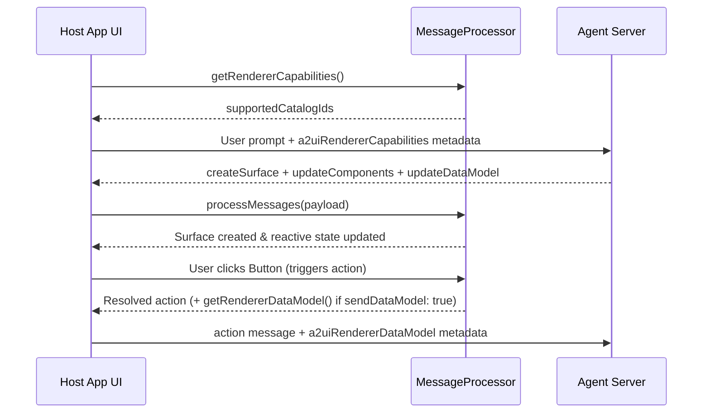

import {Aside, Tabs, TabItem} from '@astrojs/starlight/components';
import SchemaChips from '../../../components/docs/common/SchemaChips.astro';

This guide walks frontend and mobile developers through adding an A2UI [renderer](../../concepts/glossary/#renderer) to a Flutter, React, Lit, Angular, SwiftUI, or Jetpack Compose app so it can display interactive UIs streamed by an AI agent and send user actions back.

If you are building the backend agent instead, see [How to Integrate with My Agent Server](../../guides/agent-integration/). To register custom widgets beyond the built-in Basic catalog, see [How to Define a Catalog](../../guides/defining-a-catalog/) and [Authoring Universal Web Components](../../guides/authoring-universal-components/).

---

## Step 1: Install dependencies

Install the Renderer SDK and Core SDK packages for your target UI framework:

<Tabs syncKey="renderer-framework">
  <TabItem label="Flutter">

```bash
flutter pub add a2ui_flutter a2ui_core url_launcher
```

  </TabItem>
  <TabItem label="React">

```bash
# Requires react and react-dom ^18.0.0 || ^19.0.0
npm install @a2ui/react @a2ui/web_core zod
```

  </TabItem>
  <TabItem label="Lit">

```bash
npm install @a2ui/lit @a2ui/web_core lit zod
```

  </TabItem>
  <TabItem label="Angular">

```bash
# Requires @angular/core, @angular/common, and @angular/platform-browser ^21.2.5
npm install @a2ui/angular @a2ui/web_core zod
```

  </TabItem>
  <TabItem label="SwiftUI">

```swift
// Package.swift (iOS 17+ / macOS 14+)
dependencies: [
  .package(url: "https://github.com/a2ui-project/a2ui.git", branch: "main"),
  .package(url: "https://github.com/ajevans99/swift-json-schema", .upToNextMinor(from: "0.13.1")),
],
targets: [
  .target(
    name: "MyApp",
    dependencies: [
      .product(name: "A2UISwiftCore", package: "a2ui"),
      .product(name: "A2UISwiftUI", package: "a2ui"),
      .product(name: "BasicCatalogSwiftUI", package: "a2ui"),
      .product(name: "OrderedJSON", package: "swift-json-schema"),
    ]
  ),
]
```

  </TabItem>
  <TabItem label="Jetpack Compose">

`androidx.a2ui` `1.0.0-alpha02` currently targets A2UI `v0.9.1` on the wire while `v1.0` support is in progress.

```kotlin
// build.gradle.kts (add google() to your repositories block)
dependencies {
    val a2uiVersion = "1.0.0-alpha02"
    implementation("androidx.a2ui:a2ui-model:$a2uiVersion")
    implementation("androidx.a2ui:a2ui-engine:$a2uiVersion")
    implementation("androidx.a2ui.compose:compose-runtime:$a2uiVersion")
    implementation("androidx.a2ui.compose:compose-ui:$a2uiVersion")
    implementation("androidx.compose.material3:material3-a2ui:$a2uiVersion")
}
```

  </TabItem>
</Tabs>

---

## Step 2: Initialize MessageProcessor and register catalogs

Create one [`MessageProcessor`](../../concepts/glossary/#messageprocessor) instance per conversation or rendering session, wrapped in a single session controller or service that your transport layer and root UI share (wired together at the app entry point in [Step 7](#step-7-wire-everything-at-the-app-entry-point)). Register the built-in [Basic catalog](../../specification/v1.0-basic-catalog-implementation-guide/#basic_catalog.json) alongside any custom domain [catalogs](../../concepts/catalogs/) your app defines.

A2UI catalogs are extensible: the Basic catalog supplies standard layout and input widgets (`Column`, `Row`, `Card`, `Text`, `Button`, `TextField`), and you can pass additional `Catalog` instances in the `catalogs` list to render domain-specific widgets or run custom local functions. See [How to Define a Catalog](../../guides/defining-a-catalog/) to author custom catalogs across platforms.

Setting `validationConfig` to relaxed validation (`ValidationConfig.relaxed` / `RELAXED_VALIDATION` / `.relaxed`) allows incremental surface construction where component batches arrive across multiple streamed messages before the full tree is complete. Setting `reportErrorsOnly: true` tells `MessageProcessor` to emit structured validation errors to your outbound listener instead of throwing exceptions into your UI loop.

<Tabs syncKey="renderer-framework">
  <TabItem label="Flutter">

```dart
// lib/agent_session.dart
import 'dart:convert';

import 'package:a2ui_core/a2ui_core.dart';
import 'package:a2ui_flutter/a2ui_flutter.dart';
import 'package:a2ui_flutter/basic_catalog.dart';
import 'package:url_launcher/url_launcher.dart';

class AgentSession {
  AgentSession({required this.sendOverTransport}) {
    processor = MessageProcessor<ComponentImplementation>(
      catalogs: [
        basicCatalog(
          openUrl: (url) async {
            await launchUrl(url);
          },
        ),
        // Add custom Catalog<ComponentImplementation, FunctionImplementation> entries here.
      ],
      defaultVersion: A2uiProtocolVersion.v1_0, // Optional (default: null)
      validationConfig: ValidationConfig.relaxed, // Optional (default: null)
      reportErrorsOnly: true, // Optional (default: false)
      onAction: (action) {
        // Optional (default: null)
        sendToAgent(ActionMessage(version: '1.0', action: action).toJson());
      },
      outboundListener: (message) {
        // Optional (default: null; required for callAgentFunction)
        sendToAgent(message.toJson());
      },
    );
  }

  final void Function({
    required Map<String, Object?> message,
    required Map<String, Object?> metadata,
  }) sendOverTransport;

  late final MessageProcessor<ComponentImplementation> processor;
}
```

  </TabItem>
  <TabItem label="React">

```ts
// src/agent-session.ts
import type {ReactCatalogComponent} from '@a2ui/react';
import {
  type ActionPayload,
  MessageProcessor,
  RELAXED_VALIDATION,
  basicCatalog,
  injectBasicCatalogStyles,
} from '@a2ui/web_core/v1_0';

injectBasicCatalogStyles();

export class AgentSession {
  readonly processor = new MessageProcessor<ReactCatalogComponent>(
    [
      basicCatalog,
      // Add custom Catalog<ReactCatalogComponent> entries here.
    ],
    // Optional (default: undefined)
    (action: ActionPayload) => void this.sendToAgent({version: '1.0', action}),
    {
      version: '1.0', // Optional (default: undefined)
      validationConfig: RELAXED_VALIDATION, // Optional (default: undefined)
      reportErrorsOnly: true, // Optional (default: false)
      outboundListener: message => void this.sendToAgent(message), // Optional (default: undefined; required for callAgentFunction)
      errorHandler: errorMessage => void this.sendToAgent(errorMessage), // Optional (default: undefined)
    },
  );
}
```

  </TabItem>
  <TabItem label="Lit">

```ts
// src/agent-session.ts
import type {LitComponentApi} from '@a2ui/lit';
import {
  type ActionPayload,
  MessageProcessor,
  RELAXED_VALIDATION,
  basicCatalog,
  injectBasicCatalogStyles,
} from '@a2ui/web_core/v1_0';

injectBasicCatalogStyles();

export class AgentSession {
  readonly processor = new MessageProcessor<LitComponentApi>(
    [
      basicCatalog,
      // Add custom Catalog<LitComponentApi> entries here.
    ],
    // Optional (default: undefined)
    (action: ActionPayload) => void this.sendToAgent({version: '1.0', action}),
    {
      version: '1.0', // Optional (default: undefined)
      validationConfig: RELAXED_VALIDATION, // Optional (default: undefined)
      reportErrorsOnly: true, // Optional (default: false)
      outboundListener: message => void this.sendToAgent(message), // Optional (default: undefined; required for callAgentFunction)
      errorHandler: errorMessage => void this.sendToAgent(errorMessage), // Optional (default: undefined)
    },
  );
}
```

  </TabItem>
  <TabItem label="Angular">

```ts
// src/app/app.config.ts
import {ApplicationConfig, Injector, inject} from '@angular/core';
import {BasicCatalog, provideA2UI} from '@a2ui/angular';
import {
  type ActionPayload,
  RELAXED_VALIDATION,
  injectBasicCatalogStyles,
} from '@a2ui/web_core/v1_0';

import {AgentSessionService} from './agent-session.service';

injectBasicCatalogStyles();

export const appConfig: ApplicationConfig = {
  providers: [
    provideA2UI(() => {
      const injector = inject(Injector);
      const forward = (message: unknown) =>
        void injector.get(AgentSessionService).sendToAgent(message);

      return {
        catalogs: [
          new BasicCatalog(),
          // Add custom AngularCatalog entries here.
        ],
        useUniversalComponents: true, // Optional (default: true in provideA2UI)
        actionHandler: (action: ActionPayload) => forward({version: '1.0', action}), // Optional (default: undefined)
        processorOptions: {
          version: '1.0', // Optional (default: undefined)
          validationConfig: RELAXED_VALIDATION, // Optional (default: undefined)
          reportErrorsOnly: true, // Optional (default: false)
          outboundListener: message => forward(message), // Optional (default: undefined; required for callAgentFunction)
          errorHandler: errorMessage => forward(errorMessage), // Optional (default: undefined)
        },
      };
    }),
  ],
};
```

  </TabItem>
  <TabItem label="SwiftUI">

```swift
// A2UISessionController.swift
import A2UICore
import A2UISwiftUI
import BasicCatalogSwiftUI
import Combine
import Foundation

@MainActor
final class A2UISessionController: ObservableObject {
  let catalogs: [Catalog<ComponentImplementation>]
  let processor: MessageProcessor
  private let sendOverTransport: @Sendable (Data) -> Void

  init(sendOverTransport: @escaping @Sendable (Data) -> Void) {
    self.sendOverTransport = sendOverTransport
    let basic = BasicCatalogImplementation.makeCatalog(version: .v10, locale: .current)
    // Append custom Catalog<ComponentImplementation> instances to this array as needed.
    self.catalogs = [basic]
    self.processor = MessageProcessor(
      catalogs: self.catalogs.map { $0 as any CatalogProtocol },
      actionHandler: nil, // Optional (default: nil)
      validationConfig: .relaxed // Optional (default: .relaxed)
    )
    self.processor.outboundListener = { [weak self] message in
      // Receives .action, .callAgentFunction, .rendererFunctionResponse, and .error.
      Task { @MainActor [weak self] in
        try? self?.sendToAgent(message: message)
      }
    }
  }
}
```

  </TabItem>
  <TabItem label="Jetpack Compose">

```kotlin
// AgentSessionViewModel.kt
import android.app.Application
import androidx.a2ui.compose.runtime.A2uiMessageParser
import androidx.a2ui.compose.ui.A2uiMessageProcessor
import androidx.a2ui.compose.ui.catalog.A2uiBasicCatalogV1
import androidx.a2ui.model.catalog.functions.A2uiLocaleProvider
import androidx.a2ui.model.processor.A2uiSurfaceModel
import androidx.a2ui.model.processor.processInput
import androidx.compose.material3.a2ui.catalog.MaterialA2uiBasicCatalogV1Defaults
import androidx.compose.material3.a2ui.catalog.materialA2uiBasicCatalogV1
import androidx.lifecycle.AndroidViewModel
import androidx.lifecycle.viewModelScope
import kotlinx.coroutines.CoroutineStart
import kotlinx.coroutines.Dispatchers
import kotlinx.coroutines.flow.StateFlow
import kotlinx.coroutines.launch

class AgentSessionViewModel(application: Application) : AndroidViewModel(application) {
    val basicCatalog = materialA2uiBasicCatalogV1(
        image = MaterialA2uiBasicCatalogV1Defaults.image { _, _, _, _, _ -> },
        video = MaterialA2uiBasicCatalogV1Defaults.video { _, _, _ -> },
        audioPlayer = MaterialA2uiBasicCatalogV1Defaults.audioPlayer { _, _, _, _ -> },
        functions = A2uiBasicCatalogV1.Functions(application, A2uiLocaleProvider.Default),
    )

    private val parser = A2uiMessageParser()
    val processor = A2uiMessageProcessor(
        catalogs = listOf(
            basicCatalog,
            // Add custom A2uiCatalog instances here.
        ),
        interceptors = emptyList(), // Optional (default: emptyList())
    )

    val a2uiSurfaces: StateFlow<List<A2uiSurfaceModel>> = processor.activeSurfaces

    init {
        viewModelScope.launch(Dispatchers.Default) {
            processor.collectMessages()
        }
        viewModelScope.launch(start = CoroutineStart.UNDISPATCHED) {
            processor.outboundEvents.collect { event ->
                handleOutboundEvent(event)
            }
        }
    }
}
```

  </TabItem>
</Tabs>

---

## Step 3: Advertise renderer capabilities

Before the agent generates UI, generate a capabilities payload from `MessageProcessor` and attach it to your transport request [metadata](../../concepts/messages/#metadata) under the `a2uiRendererCapabilities` key. Keep `includeInlineCatalogs` at its default `false` in production when the agent already holds matching `catalogId` schemas; set it to `true` only during prototyping when the agent accepts client-supplied inline schemas.

<Tabs syncKey="renderer-framework">
  <TabItem label="Flutter">

```dart
// Inside AgentSession (lib/agent_session.dart):
Map<String, Object?> buildRequestMetadata() {
  final capabilities = processor
      .getRendererCapabilities(
        const CapabilitiesOptions(
          versions: [A2uiProtocolVersion.v1_0],
          includeInlineCatalogs: false, // Optional (default: false)
        ),
      )
      .toJson();

  return {
    'a2uiRendererCapabilities': capabilities,
  };
}
```

  </TabItem>
  <TabItem label="React">

```ts
// Inside AgentSession (src/agent-session.ts):
buildRequestMetadata() {
  return {
    a2uiRendererCapabilities: this.processor.getRendererCapabilities({
      versions: ['1.0'],
      includeInlineCatalogs: false, // Optional (default: false)
    }),
  };
}
```

  </TabItem>
  <TabItem label="Lit">

```ts
// Inside AgentSession (src/agent-session.ts):
buildRequestMetadata() {
  return {
    a2uiRendererCapabilities: this.processor.getRendererCapabilities({
      versions: ['1.0'],
      includeInlineCatalogs: false, // Optional (default: false)
    }),
  };
}
```

  </TabItem>
  <TabItem label="Angular">

```ts
// src/app/agent-session.service.ts
import {Injectable, inject} from '@angular/core';
import {A2uiRendererService} from '@a2ui/angular';

@Injectable({providedIn: 'root'})
export class AgentSessionService {
  private readonly renderer = inject(A2uiRendererService);

  buildRequestMetadata() {
    return {
      a2uiRendererCapabilities: this.renderer.processor.getRendererCapabilities({
        versions: ['1.0'],
        includeInlineCatalogs: false, // Optional (default: false)
      }),
    };
  }
}
```

  </TabItem>
  <TabItem label="SwiftUI">

```swift
// A2UISessionController.swift
import A2UICore
import OrderedJSON

extension A2UISessionController {
  func buildRequestMetadata() throws -> JSONValue {
    let capabilities = try processor.getRendererCapabilities(
      options: MessageProcessor.CapabilitiesOptions(
        versions: [.v10],
        includeInlineCatalogs: false // Optional (default: false)
      )
    )
    return [
      "a2uiRendererCapabilities": capabilities,
    ]
  }
}
```

  </TabItem>
  <TabItem label="Jetpack Compose">

Because `1.0.0-alpha02` targets A2UI `v0.9.1`, capabilities are advertised under `a2uiClientCapabilities` (keyed by `"v0.9"`):

```kotlin
// Top-level import in AgentSessionViewModel.kt:
import androidx.a2ui.model.protocol.A2uiClientCapabilities

// Inside class AgentSessionViewModel:
val capabilities = A2uiClientCapabilities(
    supportedCatalogIds = listOf(basicCatalog.id),
    inlineCatalogs = emptyList(), // Optional (default: emptyList())
)

fun buildRequestMetadata(): Map<String, Map<String, Any?>> {
    // Returns mapOf("a2uiClientCapabilities" to mapOf("v0.9" to mapOf("supportedCatalogIds" to listOf(...))))
    return capabilities.toPayloadMap()
}
```

  </TabItem>
</Tabs>

<details>
<summary>Wire format: renderer capabilities metadata</summary>

`buildRequestMetadata()` produces the transport metadata envelope below (`"1.0"` in `v1.0`, `"v0.9"` in `v0.9.1`):

<SchemaChips
  items={[
    {
      version: 'v1.0',
      label: 'renderer_capabilities.json',
      href: '/specification/v1.0/schemas/#renderer_capabilities.json',
      title: 'v1.0 Renderer Capabilities Schema',
    },
    {
      version: 'v0.9.1',
      label: 'client_capabilities.json',
      href: '/specification/v0.9.1/schemas/#client_capabilities.json',
      title: 'v0.9.1 Client Capabilities Schema',
    },
  ]}
/>

<Tabs syncKey="protocol-version">
  <TabItem label="v1.0">

```json
{
  "metadata": {
    "a2uiRendererCapabilities": {
      "1.0": {
        "supportedCatalogIds": ["https://a2ui.org/specification/v1_0/catalogs/basic/catalog.json"]
      }
    }
  }
}
```

  </TabItem>
  <TabItem label="v0.9.1">

```json
{
  "metadata": {
    "a2uiClientCapabilities": {
      "v0.9": {
        "supportedCatalogIds": ["https://a2ui.org/specification/v0_9/catalogs/basic/catalog.json"]
      }
    }
  }
}
```

  </TabItem>
</Tabs>

</details>

---

## Step 4: Connect your transport and apply updates

A2UI is transport-agnostic: your app can receive messages over Server-Sent Events (SSE), WebSockets, HTTP chunked streams, [A2A](../../specification/v1.0-a2ui-extension-specification/), or [MCP](../../guides/mcp-overview/). Decode each incoming JSON message envelope (or array of envelopes on Flutter, Web, and Swift; one JSON message object per call on Jetpack Compose's `A2uiMessageParser`) and pass it to `MessageProcessor`.

On Web, call `processMessagesAsync()` to await any asynchronous renderer functions invoked via [`callRendererFunction`](../../concepts/messages/#callrendererfunction-v10-only) messages. On Flutter, `processMessages()` dispatches async renderer functions in the background when `reportErrorsOnly` is `true`; to await their completion at the call site, set `reportErrorsOnly: false` and call `processMessagesAsync()`.

<Tabs syncKey="renderer-framework">
  <TabItem label="Flutter">

```dart
// Inside AgentSession (lib/agent_session.dart):
void onTransportChunk(String rawJson) {
  final Object? decoded = jsonDecode(rawJson);
  // Routes validation errors and async rendererFunctionResponse messages to outboundListener.
  processor.processMessages(decoded);
}
```

  </TabItem>
  <TabItem label="React">

```ts
// Inside AgentSession (src/agent-session.ts):
async onTransportChunk(rawJson: string): Promise<void> {
  const payload = JSON.parse(rawJson);
  await this.processor.processMessagesAsync(payload);
}
```

  </TabItem>
  <TabItem label="Lit">

```ts
// Inside AgentSession (src/agent-session.ts):
async onTransportChunk(rawJson: string): Promise<void> {
  const payload = JSON.parse(rawJson);
  await this.processor.processMessagesAsync(payload);
}
```

  </TabItem>
  <TabItem label="Angular">

```ts
// Inside AgentSessionService (src/app/agent-session.service.ts):
async onTransportChunk(rawJson: string): Promise<void> {
  const payload = JSON.parse(rawJson);
  await this.renderer.processMessagesAsync(payload);
}
```

  </TabItem>
  <TabItem label="SwiftUI">

```swift
// A2UISessionController.swift
import A2UICore
import Foundation
import OrderedJSON

extension A2UISessionController {
  func onTransportChunk(_ rawData: Data) throws {
    let payload = try JSONValue.parse(rawData)
    // Routes any validation errors to processor.outboundListener without throwing.
    processor.process(payload: payload)
  }
}
```

  </TabItem>
  <TabItem label="Jetpack Compose">

Because `1.0.0-alpha02` targets A2UI `v0.9.1`, `A2uiMessageParser` expects `"version": "v0.9"` (or `"v0.9.1"`), the `https://a2ui.org/specification/v0_9/catalogs/basic/catalog.json` catalog URI, and `{"path": "..."}` data bindings:

```kotlin
// Inside AgentSessionViewModel (AgentSessionViewModel.kt):
// Pass one JSON message object per call, not a JSON array.
fun onTransportMessage(rawJsonObject: String) {
    // Thread-safe; emits any A2uiValidationException as A2uiClientErrorMessage on outboundEvents.
    processor.processInput(parser, rawJsonObject)
}
```

  </TabItem>
</Tabs>

<details>
<summary>Wire format: streamed agent-to-renderer messages</summary>

Agents stream a [`createSurface`](../../concepts/messages/#createsurface) message followed by incremental [`updateComponents`](../../concepts/messages/#updatecomponents) and [`updateDataModel`](../../concepts/messages/#updatedatamodel) messages, and remove finished surfaces with [`deleteSurface`](../../concepts/messages/#deletesurface):

<SchemaChips
  items={[
    {
      version: 'v1.0',
      label: 'agent_to_renderer.json',
      href: '/specification/v1.0/schemas/#agent_to_renderer.json',
      title: 'v1.0 Agent-to-Renderer Message Schema',
    },
    {
      version: 'v0.9.1',
      label: 'server_to_client.json',
      href: '/specification/v0.9.1/schemas/#server_to_client.json',
      title: 'v0.9.1 Server-to-Client Message Schema',
    },
  ]}
/>

<Tabs syncKey="protocol-version">
  <TabItem label="v1.0">

```json
[
  {
    "version": "1.0",
    "createSurface": {
      "surfaceId": "order_summary",
      "catalogId": "https://a2ui.org/specification/v1_0/catalogs/basic/catalog.json",
      "sendDataModel": true
    }
  },
  {
    "version": "1.0",
    "updateComponents": {
      "surfaceId": "order_summary",
      "components": [
        {"id": "root", "component": "Card", "child": "col"},
        {"id": "col", "component": "Column", "children": ["headline", "confirm_btn"]},
        {"id": "headline", "component": "Text", "text": {"@path": "/summaryText"}},
        {
          "id": "confirm_btn",
          "component": "Button",
          "child": "confirm_label",
          "action": {
            "event": {"name": "confirm_order", "context": {"orderId": {"@path": "/orderId"}}}
          }
        },
        {"id": "confirm_label", "component": "Text", "text": "Confirm order"}
      ]
    }
  },
  {
    "version": "1.0",
    "updateDataModel": {
      "surfaceId": "order_summary",
      "path": "/",
      "value": {"orderId": "ORD-4821", "summaryText": "2 items ready for pickup"}
    }
  }
]
```

  </TabItem>
  <TabItem label="v0.9.1">

```json
[
  {
    "version": "v0.9",
    "createSurface": {
      "surfaceId": "order_summary",
      "catalogId": "https://a2ui.org/specification/v0_9/catalogs/basic/catalog.json",
      "sendDataModel": true
    }
  },
  {
    "version": "v0.9",
    "updateComponents": {
      "surfaceId": "order_summary",
      "components": [
        {"id": "root", "component": "Card", "child": "col"},
        {"id": "col", "component": "Column", "children": ["headline", "confirm_btn"]},
        {"id": "headline", "component": "Text", "text": {"path": "/summaryText"}},
        {
          "id": "confirm_btn",
          "component": "Button",
          "child": "confirm_label",
          "action": {
            "event": {"name": "confirm_order", "context": {"orderId": {"path": "/orderId"}}}
          }
        },
        {"id": "confirm_label", "component": "Text", "text": "Confirm order"}
      ]
    }
  },
  {
    "version": "v0.9",
    "updateDataModel": {
      "surfaceId": "order_summary",
      "path": "/",
      "value": {"orderId": "ORD-4821", "summaryText": "2 items ready for pickup"}
    }
  }
]
```

  </TabItem>
</Tabs>

</details>

---

## Step 5: Mount surface components

Observe the surface group managed by `MessageProcessor` so your layout mounts new [surfaces](../../concepts/glossary/#surface) when `createSurface` arrives and unmounts them when `deleteSurface` arrives. Once mounted, each surface widget observes its own component graph and `DataModel` signals internally, updating individual child widgets in place as `updateComponents` and `updateDataModel` messages stream in.

<Tabs syncKey="renderer-framework">
  <TabItem label="Flutter">

```dart
// lib/agent_surfaces_view.dart
import 'package:a2ui_core/a2ui_core.dart';
import 'package:a2ui_flutter/a2ui_flutter.dart';
import 'package:flutter/material.dart';

class AgentSurfacesView extends StatefulWidget {
  const AgentSurfacesView({super.key, required this.processor});

  final MessageProcessor<ComponentImplementation> processor;

  @override
  State<AgentSurfacesView> createState() => _AgentSurfacesViewState();
}

class _AgentSurfacesViewState extends State<AgentSurfacesView> {
  late final Subscription _createdSub;
  late final Subscription _deletedSub;

  @override
  void initState() {
    super.initState();
    _createdSub = widget.processor.model.onSurfaceCreated.subscribe((_) {
      setState(() {});
    });
    _deletedSub = widget.processor.model.onSurfaceDeleted.subscribe((_) {
      setState(() {});
    });
  }

  @override
  void dispose() {
    _createdSub.unsubscribe();
    _deletedSub.unsubscribe();
    super.dispose();
  }

  @override
  Widget build(BuildContext context) {
    final surfaces = widget.processor.model.allSurfaces;
    return ListView(
      children: [
        for (final surface in surfaces)
          KeyedSubtree(
            key: ValueKey(surface.id),
            child: A2uiSurface(surface: surface),
          ),
      ],
    );
  }
}
```

  </TabItem>
  <TabItem label="React">

```tsx
// src/AgentSurfaces.tsx
import {A2uiSurface, type ReactCatalogComponent} from '@a2ui/react';
import type {MessageProcessor, SurfaceModel} from '@a2ui/web_core/v1_0';
import {useEffect, useState} from 'react';

export function AgentSurfaces({processor}: {processor: MessageProcessor<ReactCatalogComponent>}) {
  const [surfaces, setSurfaces] = useState<SurfaceModel<ReactCatalogComponent>[]>(() =>
    Array.from(processor.getSurfaces().values()),
  );

  useEffect(() => {
    const sync = () => setSurfaces(Array.from(processor.getSurfaces().values()));
    const createdSub = processor.onSurfaceCreated(sync);
    const deletedSub = processor.onSurfaceDeleted(sync);
    sync();
    return () => {
      createdSub.unsubscribe();
      deletedSub.unsubscribe();
    };
  }, [processor]);

  return (
    <div className="a2ui-surfaces">
      {surfaces.map(surface => (
        <A2uiSurface key={surface.id} surface={surface} />
      ))}
    </div>
  );
}
```

  </TabItem>
  <TabItem label="Lit">

```ts
// src/agent-surfaces.ts
import '@a2ui/lit';
import type {LitComponentApi} from '@a2ui/lit';
import type {MessageProcessor, Subscription} from '@a2ui/web_core/v1_0';
import {LitElement, html} from 'lit';
import {customElement, property} from 'lit/decorators.js';
import {repeat} from 'lit/directives/repeat.js';

@customElement('agent-surfaces')
export class AgentSurfacesElement extends LitElement {
  @property({attribute: false})
  accessor processor!: MessageProcessor<LitComponentApi>;

  private subscriptions: Subscription[] = [];

  override connectedCallback() {
    super.connectedCallback();
    if (this.processor) {
      this.subscriptions.push(
        this.processor.onSurfaceCreated(() => this.requestUpdate()),
        this.processor.onSurfaceDeleted(() => this.requestUpdate()),
      );
    }
  }

  override disconnectedCallback() {
    for (const sub of this.subscriptions) {
      sub.unsubscribe();
    }
    this.subscriptions = [];
    super.disconnectedCallback();
  }

  override render() {
    const surfaces = this.processor ? Array.from(this.processor.getSurfaces().values()) : [];
    return html`
      ${repeat(
        surfaces,
        surface => surface.id,
        surface => html`<a2ui-surface .surface=${surface}></a2ui-surface>`,
      )}
    `;
  }
}
```

  </TabItem>
  <TabItem label="Angular">

```ts
// src/app/agent-surfaces.component.ts
import {ChangeDetectionStrategy, Component, DestroyRef, inject, signal} from '@angular/core';
import {A2uiRendererService, SurfaceComponent} from '@a2ui/angular';

@Component({
  selector: 'app-agent-surfaces',
  standalone: true,
  imports: [SurfaceComponent],
  changeDetection: ChangeDetectionStrategy.OnPush,
  template: `
    @for (surfaceId of surfaceIds(); track surfaceId) {
      <a2ui-v09-surface [surfaceId]="surfaceId" />
    }
  `,
})
export class AgentSurfacesComponent {
  private readonly renderer = inject(A2uiRendererService);
  private readonly destroyRef = inject(DestroyRef);

  readonly surfaceIds = signal<string[]>(this.readSurfaceIds());

  constructor() {
    const sync = () => this.surfaceIds.set(this.readSurfaceIds());
    const createdSub = this.renderer.surfaceGroup.onSurfaceCreated.subscribe(sync);
    const deletedSub = this.renderer.surfaceGroup.onSurfaceDeleted.subscribe(sync);
    this.destroyRef.onDestroy(() => {
      createdSub.unsubscribe();
      deletedSub.unsubscribe();
    });
  }

  private readSurfaceIds(): string[] {
    return Array.from(this.renderer.surfaceGroup.surfacesMap.keys());
  }
}
```

<Aside type="caution" title="Angular surface selector name">
  In `@a2ui/angular`, `SurfaceComponent` currently uses the `<a2ui-v09-surface>` selector for A2UI
  `v1.0` surfaces (tracked in [#4009](https://github.com/a2ui-project/a2ui/issues/4009)). The
  unversioned `<a2ui-surface>` selector in `@a2ui/angular/v0_8` belongs only to the legacy `v0.8`
  renderer.
</Aside>

  </TabItem>
  <TabItem label="SwiftUI">

```swift
// AgentSurfacesView.swift
import A2UICore
import A2UISwiftUI
import SwiftUI

struct AgentSurfacesView: View {
  @ObservedObject var surfaceGroup: SurfaceGroupModel
  let catalogs: [Catalog<ComponentImplementation>]

  var body: some View {
    ScrollView {
      VStack(alignment: .leading, spacing: 16) {
        ForEach(surfaceGroup.surfacesMap.keys.sorted(), id: \.self) { surfaceID in
          if let viewModel = surfaceGroup.surfacesMap[surfaceID] {
            Surface(viewModel: viewModel, catalogs: catalogs)
          }
        }
      }
      .padding()
    }
  }
}
```

  </TabItem>
  <TabItem label="Jetpack Compose">

```kotlin
// AgentSurfacesScreen.kt
import androidx.compose.foundation.layout.Arrangement
import androidx.compose.foundation.layout.Column
import androidx.compose.foundation.layout.fillMaxWidth
import androidx.compose.material3.a2ui.A2uiSurface
import androidx.compose.runtime.Composable
import androidx.compose.runtime.getValue
import androidx.compose.runtime.key
import androidx.compose.ui.Modifier
import androidx.compose.ui.unit.dp
import androidx.lifecycle.compose.collectAsStateWithLifecycle

@Composable
fun AgentSurfacesScreen(viewModel: AgentSessionViewModel, modifier: Modifier = Modifier) {
    val surfaces by viewModel.a2uiSurfaces.collectAsStateWithLifecycle()

    Column(
        modifier = modifier.fillMaxWidth(),
        verticalArrangement = Arrangement.spacedBy(16.dp),
    ) {
        surfaces.forEach { surface ->
            key(surface.id) {
                A2uiSurface(surfaceModel = surface)
            }
        }
    }
}
```

  </TabItem>
</Tabs>

---

## Step 6: Handle outbound actions, RPCs, and errors

Renderers emit outbound messages when a user triggers an [`action`](../../concepts/messages/#action), when an expression invokes [`callAgentFunction`](../../concepts/messages/#callagentfunction-v10-only) or returns [`rendererFunctionResponse`](../../concepts/messages/#rendererfunctionresponse-v10-only), or when payload validation produces an [`error`](../../specification/v1.0/schemas/#renderer_to_agent.json/properties/error).

When an active surface was created with `"sendDataModel": true` (for example, a form where local `TextField`, `CheckBox`, or `Slider` edits mutate the client `DataModel` without firing individual events), attach `getRendererDataModel()` to outbound transport metadata under `a2uiRendererDataModel` alongside both outbound messages and subsequent user chat prompts.

<Tabs syncKey="renderer-framework">
  <TabItem label="Flutter">

```dart
// Inside AgentSession (lib/agent_session.dart):
Map<String, Object?> buildOutboundMetadata() {
  final dataModel = processor.getRendererDataModel();
  return {
    ...buildRequestMetadata(),
    if (dataModel != null) 'a2uiRendererDataModel': dataModel,
  };
}

void sendToAgent(Map<String, Object?> wireMessage) {
  sendOverTransport(message: wireMessage, metadata: buildOutboundMetadata());
}
```

  </TabItem>
  <TabItem label="React">

```ts
// Inside AgentSession (src/agent-session.ts):
buildOutboundMetadata(): Record<string, unknown> {
  const dataModel = this.processor.getRendererDataModel();
  return {
    ...this.buildRequestMetadata(),
    ...(dataModel !== undefined ? {a2uiRendererDataModel: dataModel} : {}),
  };
}

async sendToAgent(wireMessage: unknown): Promise<void> {
  const response = await fetch('/api/agent', {
    method: 'POST',
    headers: {'Content-Type': 'application/json'},
    body: JSON.stringify({message: wireMessage, metadata: this.buildOutboundMetadata()}),
  });
  await this.onTransportChunk(await response.text());
}
```

  </TabItem>
  <TabItem label="Lit">

```ts
// Inside AgentSession (src/agent-session.ts):
buildOutboundMetadata(): Record<string, unknown> {
  const dataModel = this.processor.getRendererDataModel();
  return {
    ...this.buildRequestMetadata(),
    ...(dataModel !== undefined ? {a2uiRendererDataModel: dataModel} : {}),
  };
}

async sendToAgent(wireMessage: unknown): Promise<void> {
  const response = await fetch('/api/agent', {
    method: 'POST',
    headers: {'Content-Type': 'application/json'},
    body: JSON.stringify({message: wireMessage, metadata: this.buildOutboundMetadata()}),
  });
  await this.onTransportChunk(await response.text());
}
```

  </TabItem>
  <TabItem label="Angular">

```ts
// Inside AgentSessionService (src/app/agent-session.service.ts):
buildOutboundMetadata(): Record<string, unknown> {
  const dataModel = this.renderer.processor.getRendererDataModel();
  return {
    ...this.buildRequestMetadata(),
    ...(dataModel !== undefined ? {a2uiRendererDataModel: dataModel} : {}),
  };
}

async sendToAgent(wireMessage: unknown): Promise<void> {
  const response = await fetch('/api/agent', {
    method: 'POST',
    headers: {'Content-Type': 'application/json'},
    body: JSON.stringify({message: wireMessage, metadata: this.buildOutboundMetadata()}),
  });
  await this.onTransportChunk(await response.text());
}
```

  </TabItem>
  <TabItem label="SwiftUI">

```swift
// A2UISessionController.swift
import A2UICore
import Foundation
import OrderedJSON

extension A2UISessionController {
  func buildOutboundMetadata() throws -> JSONValue {
    let capabilities = try processor.getRendererCapabilities(
      options: MessageProcessor.CapabilitiesOptions(versions: [.v10])
    )
    if let dataModel = try processor.getRendererDataModel() {
      return [
        "a2uiRendererCapabilities": capabilities,
        "a2uiRendererDataModel": dataModel,
      ]
    }
    return [
      "a2uiRendererCapabilities": capabilities,
    ]
  }

  func sendToAgent(message: RendererToAgentMessage) throws {
    let messageData = try JSONEncoder().encode(message)
    let envelope: JSONValue = [
      "message": try JSONValue.parse(messageData),
      "metadata": try buildOutboundMetadata(),
    ]
    sendOverTransport(try JSONEncoder().encode(envelope))
  }
}
```

  </TabItem>
  <TabItem label="Jetpack Compose">

Because `1.0.0-alpha02` targets A2UI `v0.9.1`, outbound envelopes set `"version"` to `"v0.9"` and attach synchronized state under `a2uiClientDataModel`:

```kotlin
// Top-level imports in AgentSessionViewModel.kt:
import androidx.a2ui.model.protocol.A2uiClientErrorMessage
import androidx.a2ui.model.protocol.A2uiClientEventMessage
import androidx.a2ui.model.protocol.A2uiClientToServerMessage
import java.time.Instant

// Inside class AgentSessionViewModel:
private fun handleOutboundEvent(event: A2uiClientToServerMessage) {
    when (event) {
        is A2uiClientEventMessage -> {
            val wireMessage = mapOf(
                "version" to "v0.9",
                "action" to mapOf(
                    "name" to event.type,
                    "surfaceId" to event.surfaceId,
                    "sourceComponentId" to event.componentId,
                    "timestamp" to Instant.ofEpochMilli(event.timestamp).toString(),
                    "context" to event.context,
                ),
            )
            val metadata = buildMap<String, Any?> {
                putAll(capabilities.toPayloadMap())
                // Automatically populated when the surface sets sendDataModel = true.
                event.clientDataModel?.let {
                    put(
                        "a2uiClientDataModel",
                        mapOf("version" to "v0.9", "surfaces" to it.surfaces),
                    )
                }
            }
            sendOverTransport(wireMessage, metadata)
        }
        is A2uiClientErrorMessage -> {
            val wireError = mapOf(
                "version" to "v0.9",
                "error" to mapOf(
                    "code" to event.code,
                    "surfaceId" to event.surfaceId,
                    "message" to event.message,
                ) + event.context,
            )
            sendOverTransport(wireError, capabilities.toPayloadMap())
        }
    }
}

private fun sendOverTransport(message: Map<String, Any?>, metadata: Map<String, Any?>) {
    // POST mapOf("message" to message, "metadata" to metadata) to your agent endpoint
    // and pass streamed JSON message objects back to onTransportMessage(...).
}
```

  </TabItem>
</Tabs>

<details>
<summary>Wire format: outbound action message and data-model metadata</summary>

When the user clicks the button on the `"sendDataModel": true` surface from Step 4, the client sends the wire envelope below:

<SchemaChips
  items={[
    {
      version: 'v1.0',
      label: 'renderer_to_agent.json',
      href: '/specification/v1.0/schemas/#renderer_to_agent.json',
      title: 'v1.0 Renderer-to-Agent Message Schema',
    },
    {
      version: 'v1.0',
      label: 'renderer_data_model.json',
      href: '/specification/v1.0/schemas/#renderer_data_model.json',
      title: 'v1.0 Renderer Data Model Metadata Schema',
    },
    {
      version: 'v0.9.1',
      label: 'client_to_server.json',
      href: '/specification/v0.9.1/schemas/#client_to_server.json',
      title: 'v0.9.1 Client-to-Server Message Schema',
    },
    {
      version: 'v0.9.1',
      label: 'client_data_model.json',
      href: '/specification/v0.9.1/schemas/#client_data_model.json',
      title: 'v0.9.1 Client Data Model Metadata Schema',
    },
  ]}
/>

<Tabs syncKey="protocol-version">
  <TabItem label="v1.0">

```json
{
  "message": {
    "version": "1.0",
    "action": {
      "name": "confirm_order",
      "surfaceId": "order_summary",
      "sourceComponentId": "confirm_btn",
      "timestamp": "2026-05-01T18:30:00.000Z",
      "context": {
        "orderId": "ORD-4821"
      }
    }
  },
  "metadata": {
    "a2uiRendererDataModel": {
      "version": "1.0",
      "surfaces": {
        "order_summary": {
          "orderId": "ORD-4821",
          "summaryText": "2 items ready for pickup"
        }
      }
    }
  }
}
```

  </TabItem>
  <TabItem label="v0.9.1">

```json
{
  "message": {
    "version": "v0.9",
    "action": {
      "name": "confirm_order",
      "surfaceId": "order_summary",
      "sourceComponentId": "confirm_btn",
      "timestamp": "2026-05-01T18:30:00.000Z",
      "context": {
        "orderId": "ORD-4821"
      }
    }
  },
  "metadata": {
    "a2uiClientDataModel": {
      "version": "v0.9",
      "surfaces": {
        "order_summary": {
          "orderId": "ORD-4821",
          "summaryText": "2 items ready for pickup"
        }
      }
    }
  }
}
```

  </TabItem>
</Tabs>

</details>

---

## Step 7: Wire everything at the app entry point

Connect the session controller or service from Steps 2 through 6 to your app's bootstrap entry point so user prompts, streamed responses, outbound actions, and the mounted surface view share a single `MessageProcessor`:

<Tabs syncKey="renderer-framework">
  <TabItem label="Flutter">

```dart
// lib/main.dart
import 'package:flutter/material.dart';

import 'agent_session.dart';
import 'agent_surfaces_view.dart';

void main() {
  late final AgentSession session;
  session = AgentSession(
    sendOverTransport: ({required message, required metadata}) {
      // POST {'message': message, 'metadata': metadata} to your agent endpoint
      // and pass each streamed JSON chunk back to session.onTransportChunk(chunk).
    },
  );

  runApp(
    MaterialApp(
      home: Scaffold(
        body: AgentSurfacesView(processor: session.processor),
        floatingActionButton: FloatingActionButton(
          onPressed: () {
            final metadata = session.buildOutboundMetadata();
            // Start an agent turn with `metadata` and pass each streamed JSON chunk to
            // `session.onTransportChunk(chunk)`.
          },
          child: const Icon(Icons.send),
        ),
      ),
    ),
  );
}
```

  </TabItem>
  <TabItem label="React">

```tsx
// src/App.tsx (mounted via createRoot(document.getElementById('root')!).render(<App />) in src/main.tsx)
import {useState} from 'react';

import {AgentSurfaces} from './AgentSurfaces';
import {AgentSession} from './agent-session';

export function App() {
  const [session] = useState(() => new AgentSession());

  async function startPrompt(prompt: string) {
    const response = await fetch('/api/agent', {
      method: 'POST',
      headers: {'Content-Type': 'application/json'},
      body: JSON.stringify({prompt, metadata: session.buildOutboundMetadata()}),
    });
    await session.onTransportChunk(await response.text());
  }

  return (
    <main>
      <button type="button" onClick={() => void startPrompt('Show my order summary')}>
        Ask Agent
      </button>
      <AgentSurfaces processor={session.processor} />
    </main>
  );
}
```

  </TabItem>
  <TabItem label="Lit">

```ts
// src/my-app.ts (loaded from index.html containing <my-app></my-app>)
import {LitElement, html} from 'lit';
import {customElement} from 'lit/decorators.js';

import {AgentSession} from './agent-session.js';
import './agent-surfaces.js';

@customElement('my-app')
export class MyAppElement extends LitElement {
  private readonly session = new AgentSession();

  private async startPrompt(prompt: string) {
    const response = await fetch('/api/agent', {
      method: 'POST',
      headers: {'Content-Type': 'application/json'},
      body: JSON.stringify({prompt, metadata: this.session.buildOutboundMetadata()}),
    });
    await this.session.onTransportChunk(await response.text());
  }

  override render() {
    return html`
      <button type="button" @click=${() => void this.startPrompt('Show my order summary')}>
        Ask Agent
      </button>
      <agent-surfaces .processor=${this.session.processor}></agent-surfaces>
    `;
  }
}
```

  </TabItem>
  <TabItem label="Angular">

```ts
// src/main.ts
import {bootstrapApplication} from '@angular/platform-browser';

import {AppComponent} from './app/app.component';
import {appConfig} from './app/app.config';

bootstrapApplication(AppComponent, appConfig).catch(err => console.error(err));

// src/app/app.component.ts
import {ChangeDetectionStrategy, Component, inject} from '@angular/core';

import {AgentSessionService} from './agent-session.service';
import {AgentSurfacesComponent} from './agent-surfaces.component';

@Component({
  selector: 'app-root',
  standalone: true,
  imports: [AgentSurfacesComponent],
  changeDetection: ChangeDetectionStrategy.OnPush,
  template: `
    <button type="button" (click)="startPrompt('Show my order summary')">Ask Agent</button>
    <app-agent-surfaces />
  `,
})
export class AppComponent {
  private readonly session = inject(AgentSessionService);

  async startPrompt(prompt: string): Promise<void> {
    const response = await fetch('/api/agent', {
      method: 'POST',
      headers: {'Content-Type': 'application/json'},
      body: JSON.stringify({prompt, metadata: this.session.buildOutboundMetadata()}),
    });
    await this.session.onTransportChunk(await response.text());
  }
}
```

  </TabItem>
  <TabItem label="SwiftUI">

```swift
// MyApp.swift
import Foundation
import OrderedJSON
import SwiftUI

@main
struct MyApp: App {
  @StateObject private var session = A2UISessionController { outboundBytes in
    // POST outboundBytes to your agent endpoint and pass streamed chunks back to
    // session.onTransportChunk(_:)
    _ = outboundBytes
  }

  var body: some Scene {
    WindowGroup {
      VStack {
        Button("Ask Agent") {
          Task {
            let metadata = try session.buildOutboundMetadata()
            let requestBody: JSONValue = [
              "prompt": "Show my order summary",
              "metadata": metadata,
            ]
            _ = try JSONEncoder().encode(requestBody)
            // Send encoded requestBody over URLSession and pass each response chunk to:
            // try session.onTransportChunk(chunkData)
          }
        }
        AgentSurfacesView(
          surfaceGroup: session.processor.surfaceGroupModel,
          catalogs: session.catalogs
        )
      }
    }
  }
}
```

  </TabItem>
  <TabItem label="Jetpack Compose">

```kotlin
// MainActivity.kt
import android.os.Bundle
import androidx.activity.ComponentActivity
import androidx.activity.compose.setContent
import androidx.activity.viewModels
import androidx.compose.foundation.layout.Column
import androidx.compose.material3.Button
import androidx.compose.material3.MaterialTheme
import androidx.compose.material3.Text

class MainActivity : ComponentActivity() {
    private val sessionViewModel: AgentSessionViewModel by viewModels()

    override fun onCreate(savedInstanceState: Bundle?) {
        super.onCreate(savedInstanceState)
        setContent {
            MaterialTheme {
                Column {
                    Button(
                        onClick = {
                            val metadata = sessionViewModel.buildRequestMetadata()
                            // Start an agent turn with `metadata` and pass each streamed JSON
                            // message object to `sessionViewModel.onTransportMessage(jsonObject)`.
                        },
                    ) {
                        Text("Ask Agent")
                    }
                    AgentSurfacesScreen(viewModel = sessionViewModel)
                }
            }
        }
    }
}
```

  </TabItem>
</Tabs>

---

## Configure Markdown and Basic Catalog styles on Web

On Web (`@a2ui/react`, `@a2ui/lit`, and `@a2ui/angular`), the `v1.0` Basic catalog renders through shared universal custom elements whose visual tokens and Markdown parser are configurable at startup.

### Customize Basic Catalog theme tokens

Calling `injectBasicCatalogStyles()` adopts a default stylesheet into `document.adoptedStyleSheets` (and no-ops safely during server-side rendering). Override the `--a2ui-*` CSS custom properties on `:root` or on a container element, or apply the `.a2ui-dark` / `.a2ui-light` classes to lock a color scheme:

```css
:root {
  --a2ui-color-primary: #0f766e;
  --a2ui-color-on-primary: #ffffff;
  --a2ui-color-background: #ffffff;
  --a2ui-color-surface: #f8fafc;
  --a2ui-color-on-background: #0f172a;
  --a2ui-font-family-title: 'Plus Jakarta Sans', system-ui, sans-serif;
  font-family: 'Plus Jakarta Sans', system-ui, sans-serif;
}
```

### Enable sanitized Markdown in Text components

Basic catalog `Text` components render plain text until a Markdown renderer is registered. Install `@a2ui/markdown-it` (`markdown-it` + `DOMPurify`) and register `renderMarkdown` once at application startup:

```bash
npm install @a2ui/markdown-it
```

<Tabs syncKey="web-framework">
  <TabItem label="React">

```tsx
import {renderMarkdown} from '@a2ui/markdown-it';
import {MarkdownContext} from '@a2ui/react';
import {setMarkdownRenderer} from '@a2ui/web_core/v1_0';

// Configures universal Basic Catalog <a2ui-basic-text> elements.
setMarkdownRenderer(renderMarkdown);

// Optional: also provide MarkdownContext for custom React components using useMarkdownRenderer().
export function AppRoot({children}: {children: React.ReactNode}) {
  return <MarkdownContext.Provider value={renderMarkdown}>{children}</MarkdownContext.Provider>;
}
```

  </TabItem>
  <TabItem label="Lit">

```ts
import {renderMarkdown} from '@a2ui/markdown-it';
import {setMarkdownRenderer} from '@a2ui/web_core/v1_0';

setMarkdownRenderer(renderMarkdown);
```

  </TabItem>
  <TabItem label="Angular">

```ts
import {ApplicationConfig} from '@angular/core';
import {BasicCatalog, provideA2UI, provideMarkdownRenderer} from '@a2ui/angular';
import {renderMarkdown} from '@a2ui/markdown-it';
import {setMarkdownRenderer} from '@a2ui/web_core/v1_0';

setMarkdownRenderer(renderMarkdown);

export const appConfig: ApplicationConfig = {
  providers: [
    provideA2UI({catalogs: [new BasicCatalog()]}),
    provideMarkdownRenderer(renderMarkdown),
  ],
};
```

  </TabItem>
</Tabs>

<details>
<summary>Reference: end-to-end session message flow</summary>

The sequence diagram below traces how the host app, its local `MessageProcessor`, and a remote agent server interact across a session. When the user starts a turn, the host app attaches `a2uiRendererCapabilities` to the request metadata. As the agent streams `createSurface`, `updateComponents`, and `updateDataModel` messages back, `MessageProcessor` validates each payload and updates reactive surface models that the host UI renders in place. When the user triggers a component action, `MessageProcessor` resolves any bound paths or local functions and emits an outbound `action` message (plus `a2uiRendererDataModel` metadata when requested by the surface) for the host app to send over its transport.



</details>
